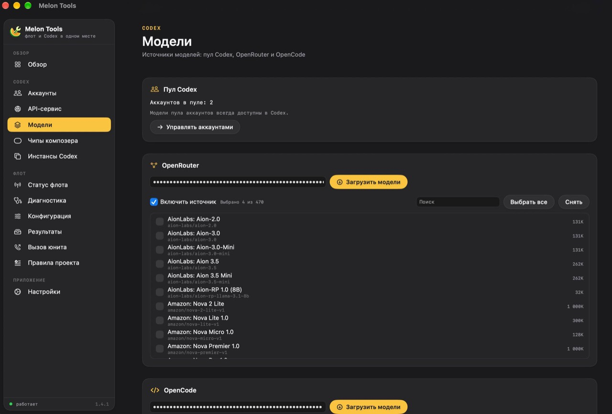
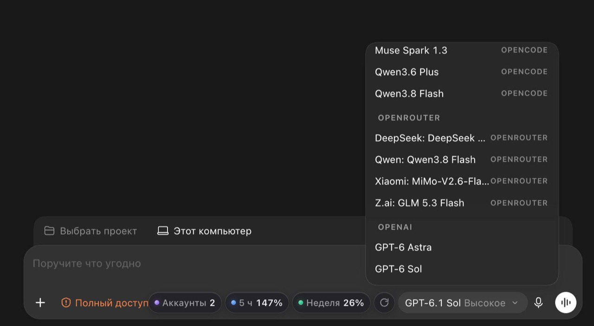

<div align="center">
  
  <h1>Melon Tools</h1>
  <p>A desktop companion for Codex accounts, model providers, and Fleet workflows on macOS and Windows.</p>
  <p>
    <a href="https://github.com/ivankuprin/MelonTools/releases/latest/download/MelonTools-1.6.4.dmg"><strong>Download for macOS</strong></a>
    · <a href="https://github.com/ivankuprin/MelonTools/releases/latest/download/MelonTools-1.6.4-win-x64.exe"><strong>Download for Windows</strong></a>
    · <a href="MacOS/README.md">Documentation</a>
    · <a href="MacOS/RELEASE_NOTES.md">Release notes</a>
    · <a href="https://github.com/ivankuprin/MelonTools/issues">Report an issue</a>
  </p>
  <p>
    
    
    
    
  </p>
</div>


## What it does

- **Manage Codex accounts** in a local vault, refresh usage, and route requests across an account pool.
- **Run a local OpenAI-compatible gateway** for Codex accounts on `127.0.0.1:18317`.
- **Connect Claude, Google Antigravity, OpenRouter and OpenCode.** Claude Pro/Max
  and Google accounts use OAuth (no API key); OpenRouter and OpenCode connect by
  API key. Selected models from every provider appear in the Codex model picker,
  and the Providers page shows live quota and account details.
- **Show account and usage chips** in the Codex desktop composer.
- **Drive Fleet CLI workflows** from a native interface: status, doctor, config, results, calls, and project rules.

The macOS app includes the complete Fleet workflow and Codex composer integration. The Windows port includes account and provider management, a local gateway, composer chips, and core Fleet views; see [Windows documentation](Windows/README.md) for current coverage.

## Screenshots

**Melon Tools — model provider management**



**Melon Tools inside Codex — model picker, account pool, and usage chips**



## Download and install

### macOS

Download [MelonTools for macOS](https://github.com/ivankuprin/MelonTools/releases/latest/download/MelonTools-1.6.4.dmg), open the DMG, and drag **Melon Tools.app** to **Applications**. The universal app supports Apple Silicon and Intel Macs running macOS 14 or later. It is ad-hoc signed and not notarized; use **right-click → Open** if Gatekeeper blocks the first launch.

### Windows

Download [MelonTools for Windows (x64)](https://github.com/ivankuprin/MelonTools/releases/latest/download/MelonTools-1.6.4-win-x64.exe) and run the `.exe`. WebView2 Runtime is required. The app is not Authenticode-signed, so Windows may show a security warning. Verify the download with the [SHA-256 checksum](https://github.com/ivankuprin/MelonTools/releases/latest/download/MelonTools-1.6.4-win-x64.exe.sha256). See [Windows documentation](Windows/README.md) for supported features and setup details.

Fleet features require Node.js 20 or later. Codex CLI and the Codex desktop app are optional integrations.

## Build from source

Prerequisites: Xcode 27+, XcodeGen, Go 1.22+, and Node.js 20+. `create-dmg` is optional.

```bash
./MacOS/scripts/fetch-sources.sh
./MacOS/build.sh
```

The Fleet CLI source is included in `MacOS/app/Resources/melon-fleet`. The fetch script checks out the pinned CLIProxyAPI source into the ignored `MacOS/_sources/` directory. The build creates a universal app and DMG under `MacOS/build/`.

Run the unit tests with:

```bash
xcodebuild \
  -project MacOS/app/MelonTools.xcodeproj \
  -scheme MelonTools \
  -configuration Debug \
  -derivedDataPath "$HOME/Library/Developer/MelonTools" \
  CODE_SIGNING_ALLOWED=NO test
```

## Privacy and security

Account credentials and provider keys are stored on the user's device. The local gateway binds to loopback; requests go to OpenAI or to the providers the user configures. The project does not include account credentials. See [the app documentation](MacOS/README.md) and [Windows documentation](Windows/README.md) for data locations and implementation details.

Please report security issues through [GitHub private vulnerability reporting](https://github.com/ivankuprin/MelonTools/security/advisories/new) when available, or contact the maintainer privately.

## License

Melon Tools is released under the [MIT License](LICENSE). Third-party component provenance is documented in [MacOS/README.md](MacOS/README.md).

Melon Tools is an independent project and is not affiliated with or endorsed by OpenAI.
